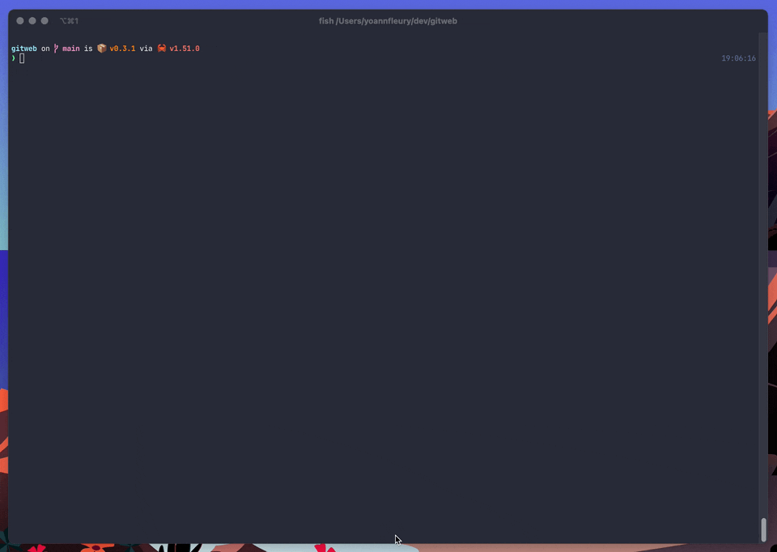

# gitweb


> Some of the flags and options are subject to change in the future.
> Ideas are welcome. Ideas are bulletproof (V).

`gitweb` is a command line interface I created mainly to learn Rust.



## Intallation

### 🍺 The homebrew way

```sh
brew install yoannfleurydev/gitweb/gitweb
# or
brew tap yoannfleurydev/gitweb
brew install gitweb
```

### 📦 The Cargo way

```sh
cargo install gitweb
```

### ⚙️ The binary way

Download the binary from the [latest release](https://github.com/yoannfleurydev/gitweb/releases/latest) and put it in your PATH.

### 🖥 The MacPorts way

```
sudo port selfupdate
sudo port install gitweb
```

## Shell completion

`gitweb` completes its options on <kbd>TAB</kbd>, as well as the branches, tags
and remotes of the current repository (`gitweb --branch <TAB>`). Add the line
for your shell to its configuration. The completion is generated at startup, so
it stays in sync when you upgrade `gitweb`.

```sh
# Bash
echo 'source <(COMPLETE=bash gitweb)' >> ~/.bashrc

# Zsh
echo 'source <(COMPLETE=zsh gitweb)' >> ~/.zshrc

# Fish
echo 'COMPLETE=fish gitweb | source' >> ~/.config/fish/completions/gitweb.fish

# Elvish
echo 'eval (E:COMPLETE=elvish gitweb | slurp)' >> ~/.elvish/rc.elv
```

```powershell
# PowerShell
echo '$env:COMPLETE = "powershell"; gitweb | Out-String | Invoke-Expression; Remove-Item Env:\COMPLETE' >> $PROFILE
```

## Usage

`gitweb` will by default open the remote in the browser of the current
repository.

```plain
Open the current remote repository in your browser

Usage: gitweb [OPTIONS]

Options:
  -b, --branch <BRANCH>    Set the branch (alias for --tag)
  -t, --tag <TAG>          Set the tag (alias for --branch)
  -M, --merge-request      Set the merge request flag
  -c, --commit <COMMIT>    Set a commit
  -B, --browser <BROWSER>  Set the browser [env: BROWSER=]
  -r, --remote <REMOTE>    Set the remote
  -v, --verbose            Set the verbosity of the command
  -h, --help               Print help (see more with '--help')
  -V, --version            Print version
```

## --branch, --tag

`gitweb` will open the current branch or tag on the remote repository. You can
override the behavior by giving either `--branch` or `--tag` flag with the
custom branch or tag you want to open in the browser.

## --browser

`gitweb` tries to start one of the following browser (in that order of priority):

- `--browser` option given in the command line
- `$BROWSER` on Linux 🐧 or `%BROWSER%` on Windows 🏁 (this is a non standard variable)
- the default web browser on the system

## --commit

`gitweb` will open the commit given as a parameter on the remote repository.

## --remote

`gitweb` will open the origin remote if it exists. You can override the behavior
by giving the `--remote` flag with the custom remote you want to open.
